# Kroma — documentación técnica del sistema

Kroma es una tienda web académica de productos tecnológicos desarrollada en PHP 8. Puede usar MySQL/MariaDB en el entorno local y PostgreSQL en Supabase mediante PDO. Incluye catálogo, cuentas, inventario, pedidos, pago simulado y un panel de administración. Los productos, precios, existencias y pagos de demostración no representan ofertas ni operaciones comerciales reales.

## Índice

- [Requisitos e instalación](#requisitos-e-instalación)
- [Arquitectura](#arquitectura)
- [Usuarios y roles](#usuarios-y-roles)
- [Modelo entidad–relación](#modelo-entidadrelación)
- [Descripción de tablas](#descripción-de-tablas)
- [SQL: DDL, DML y DCL](#sql-ddl-dml-y-dcl)
- [Consultas de ejemplo](#consultas-de-ejemplo)
- [Trigger y auditoría](#trigger-y-auditoría)
- [Transacciones, ACID, COMMIT y ROLLBACK](#transacciones-acid-commit-y-rollback)
- [Seguridad y límites](#seguridad-y-límites)
- [Publicar con Supabase](docs/DESPLIEGUE_SUPABASE.md)

## Requisitos e instalación

### Requisitos

- PHP 8 con PDO MySQL, Fileinfo y soporte para imágenes JPG, PNG y WebP.
- MySQL o MariaDB con InnoDB.
- Apache y `mod_rewrite` (por ejemplo, mediante XAMPP).
- Para Supabase: extensión PHP `pdo_pgsql`; el alojamiento del backend debe proporcionar PHP y conexión HTTPS.

### Instalación limpia

1. Copiá el proyecto en `C:\xampp\htdocs\Kroma` e iniciá Apache y MySQL.
2. En phpMyAdmin o desde la consola, importá primero `database/schema.sql` y luego `database/seed.sql`. El esquema configura `utf8mb4` y genera las tablas; **al importar `schema.sql` se eliminan y vuelven a crear las tablas**, por lo que se pierden los datos existentes.
3. Copiá `.env.example` como `.env` y ajustá host, puerto, base, usuario y contraseña si tu instalación de MySQL usa otros valores. La aplicación lee `.env` automáticamente; las variables definidas en Apache o Windows tienen prioridad.
4. Abrí `http://localhost/kroma/`. Apache reescribe la ruta a `public/`; también podés entrar por `http://localhost/kroma/public/`.

Para conectar el backend a PostgreSQL/Supabase en un servidor online, configura `DB_DRIVER=pgsql` y las variables de conexión privadas del alojamiento siguiendo la [guía de despliegue Supabase](docs/DESPLIEGUE_SUPABASE.md). GitHub Pages no ejecuta PHP; GitHub se usa para alojar el código fuente y el servicio PHP para ejecutar la tienda.

Para una instalación local, `APP_DEBUG=0` es el valor seguro de referencia. Si necesitás ver errores durante el desarrollo local, cambialo a `1` solo en tu archivo `.env`; ese archivo no se sube al repositorio.

El [manual operativo](docs/Manual_del_sistema_Kroma.docx) y el [informe técnico vigente](docs/INFORME_TECNICO_KROMA.md) están en `docs/`.

### Repositorio y publicación web

El proyecto está preparado para subir su código a un repositorio Git: `.gitignore` excluye configuración local, sesiones, logs y el ZIP de entrega. Antes de hacer público el repositorio, comprobá que `.env` no esté agregado y que los datos cargados sean únicamente de demostración.

**GitHub Pages no puede ejecutar esta aplicación**, porque su entrada es `public/index.php` y depende de PHP, Apache y MySQL. Pages publica archivos estáticos HTML/CSS/JavaScript; subir Kroma allí no habilitará el inicio de sesión, carrito, compra ni conexión a la base. Para mostrar la aplicación funcional, usá un alojamiento compatible con PHP y MySQL. Si la consigna exige Pages, prepará una versión estática separada con `index.html` en la raíz publicada y rutas relativas a sus propios recursos; no reemplaces el punto de entrada de esta aplicación PHP.

### Actualización de una base existente

Si partís de una base anterior, revisá qué cambios ya tiene y aplicá **solo las migraciones que falten**, en orden cronológico. No vuelvas a importar `schema.sql` sobre una base con datos: elimina y reconstruye las tablas. Las migraciones `ALTER TABLE` no son todas repetibles.

| Archivo | Cambio |
|---|---|
| `migration_20261026_single_session_remove_seller.sql` | Agrega el control de sesión única y convierte el rol vendedor en cliente. |
| `migration_20261028_product_image_urls.sql` | Amplía las rutas de imágenes para admitir URL largas. |
| `migration_20261103_support_messages.sql` | Crea la tabla de consultas de soporte. |
| `migration_20261106_product_uploaded_images.sql` | Prepara el esquema para imágenes de producto subidas. |
| `migration_20261106_assign_all_product_images.sql` | Asigna las imágenes locales existentes a productos. Ejecutala después de copiar las imágenes. |
| `migration_20261111_admin_stock_notifications.sql` | Crea las notificaciones de administración por inventario. |
| `migration_20261111_product_characteristics.sql` | Completa especificaciones del catálogo. |
| `migration_20261112_user_dni.sql` | Agrega el DNI opcional al perfil de usuario. |
| `migration_20261113_order_dni.sql` | Agrega el DNI histórico del comprador al pedido. |
| `migration_20261116_order_billing_data.sql` | Agrega ciudad y código postal históricos al pedido. |

### Cuentas de demostración

| Rol | Correo | Contraseña |
|---|---|---|
| Administrador | `admin@kroma.test` | `KromaAdmin2026!` |
| Cliente | `cliente@kroma.test` | `KromaCliente2026!` |
| Cliente adicional | `lucia@kroma.test` | `KromaCliente22026!` |

Son credenciales públicas de prueba. Cambialas o desactivalas antes de cualquier despliegue.

## Arquitectura

El punto de entrada web es `public/index.php`. El flujo de una solicitud es:

1. El **router** (`app/Core/Router.php`) valida la acción solicitada.
2. El **controlador** (`app/Controllers/StoreController.php`) aplica autenticación, CSRF y reglas de negocio.
3. Los servicios (`app/Services/Store.php`, `Cart.php`, `Auth.php` y `ProductArtwork.php`) reúnen operaciones de catálogo, carrito, sesión y recursos visuales.
4. `app/Core/Database.php` crea la conexión PDO con consultas preparadas.
5. Las vistas de `app/Views/` producen HTML; los estilos y scripts viven en `public/assets/`.

Los archivos de configuración, código PHP, scripts SQL y sesiones se guardan fuera de `public/`. En producción, Apache debería apuntar directamente a `public/`.

## Usuarios y roles

`roles` contiene los roles de la aplicación y `usuarios.id_rol` asigna uno a cada cuenta. Actualmente existen:

- **cliente**: crea su cuenta, modifica sus datos, administra favoritos, carrito y direcciones, y consulta sus propios pedidos.
- **administrador**: gestiona productos, precios, publicación, pedidos e inventario de consulta.

El rol de vendedor fue retirado. Las antiguas cuentas de vendedor se conservan como clientes para mantener su información sin conservar permisos operativos.

El registro solicita nombre, apellido, correo y contraseña. El teléfono y el DNI se pueden editar después desde el perfil; el DNI también se solicita durante el checkout y queda guardado en el pedido como dato histórico. La contraseña se almacena mediante `password_hash()`; no se guarda en texto plano. La aplicación permite una sesión activa por cuenta: guarda un hash del identificador de sesión y renueva su actividad durante el uso. La sesión expira tras 30 minutos sin actividad.

Los roles de esta tabla **no son** los usuarios ni privilegios de MySQL. Los permisos del motor se configuran aparte mediante DCL.

## Modelo entidad–relación

El diagrama presenta las relaciones principales. `||` representa uno, `o|` cero o uno y `o{` cero o muchos. El modelo incluye entidades auxiliares sin relación directa con el flujo de compra actual, como sucursales y configuración de envío.

```mermaid
erDiagram
    ROLES ||--o{ USUARIOS : asigna
    USUARIOS ||--o{ DIRECCIONES : registra
    CATEGORIAS o|--o{ CATEGORIAS : jerarquia
    CATEGORIAS ||--o{ PRODUCTOS : categoria_principal
    MARCAS ||--o{ PRODUCTOS : identifica
    PRODUCTOS ||--o{ PRODUCTO_CATEGORIA : clasifica
    CATEGORIAS ||--o{ PRODUCTO_CATEGORIA : agrupa
    PRODUCTOS ||--o{ IMAGENES_PRODUCTO : ilustra
    PRODUCTOS ||--o| PRODUCTO_FUENTE_IMAGEN : referencia
    PRODUCTOS ||--o{ ESPECIFICACIONES_PRODUCTO : describe
    PRODUCTOS ||--o{ PROMOCIONES : promociona
    PRODUCTOS ||--o| INVENTARIO : controla
    PRODUCTOS ||--o{ UNIDADES_USADAS : individualiza
    USUARIOS ||--o{ CARRITOS : posee
    CARRITOS ||--o{ DETALLE_CARRITO : contiene
    PRODUCTOS ||--o{ DETALLE_CARRITO : agrega
    USUARIOS ||--o{ FAVORITOS : guarda
    PRODUCTOS ||--o{ FAVORITOS : recibe
    USUARIOS ||--o{ PEDIDOS : realiza
    DIRECCIONES o|--o{ PEDIDOS : referencia
    PEDIDOS ||--|{ DETALLE_PEDIDO : incluye
    PRODUCTOS ||--o{ DETALLE_PEDIDO : conserva_producto
    UNIDADES_USADAS o|--o| DETALLE_PEDIDO : reserva_unidad
    PEDIDOS ||--o| PAGOS : registra
    PEDIDOS ||--o{ HISTORIAL_PEDIDOS : cambia_estado
    USUARIOS o|--o{ HISTORIAL_PEDIDOS : responsable
    PRODUCTOS ||--o{ MOVIMIENTOS_INVENTARIO : mueve
    UNIDADES_USADAS o|--o{ MOVIMIENTOS_INVENTARIO : unidad
    PEDIDOS o|--o{ MOVIMIENTOS_INVENTARIO : origina
    USUARIOS o|--o{ MOVIMIENTOS_INVENTARIO : responsable
    USUARIOS o|--o{ AUDITORIA : actor
    USUARIOS o|--o{ CONSULTAS_SOPORTE : envia
    PRODUCTOS o|--o{ NOTIFICACIONES_ADMINISTRADOR : alerta
    PEDIDOS o|--o{ NOTIFICACIONES_ADMINISTRADOR : alerta
    SUCURSALES {
        int id_sucursal PK
    }
    CONFIGURACION_ENVIO {
        int id_configuracion PK
    }
```



`productos.id_categoria` conserva la categoría principal del producto. `producto_categoria` permite clasificarlo también en grupos adicionales; por ejemplo, los controles y periféricos de juego pueden aparecer en Gaming sin duplicar sus filas de producto.

## Descripción de tablas

El esquema crea 26 tablas en InnoDB. Las claves primarias identifican filas; las claves foráneas aplican integridad referencial. Los índices y restricciones `UNIQUE`, `CHECK` y `ENUM` evitan varios estados o valores inválidos a nivel de base.

### Cuentas y catálogo

| Tabla | Propósito y relaciones |
|---|---|
| `roles` | Catálogo de roles; nombre único. Actualmente: cliente y administrador. |
| `usuarios` | Cuenta, contacto, hash de contraseña, estado, rol y fechas. Incluye `token_sesion` y `sesion_actividad` para la sesión única. El correo es único. |
| `direcciones` | Direcciones de una cuenta. Al borrar el usuario, sus direcciones se eliminan (`ON DELETE CASCADE`). |
| `categorias` | Categorías jerárquicas mediante `id_categoria_padre`; cada slug es único. |
| `marcas` | Catálogo de marcas; nombres y slugs únicos. |
| `productos` | Datos comerciales del artículo, precio, condición, garantía y publicación; referencia una marca y su categoría principal. |
| `producto_categoria` | Relación muchos a muchos entre productos y categorías adicionales. Clave compuesta por producto y categoría. |
| `imagenes_producto` | Rutas de las imágenes, texto alternativo, orden e indicador de imagen principal. Un producto puede tener varias. |
| `producto_fuente_imagen` | Fuente o página de referencia de imagen, como máximo una fila por producto. |
| `especificaciones_producto` | Atributos técnicos por producto: atributo, valor y unidad opcional. |
| `promociones` | Precio promocional, período y estado de una promoción asociada a un producto. |
| `consultas_soporte` | Mensajes enviados desde Soporte, con estado de seguimiento y usuario opcional asociado. |

### Inventario y trazabilidad

| Tabla | Propósito y relaciones |
|---|---|
| `inventario` | Existencia disponible y reservada. `id_producto` es único, por lo que cada producto tiene como máximo una fila. |
| `unidades_usadas` | Unidades usadas o reacondicionadas con código único, estado de conservación y disponibilidad individual. |
| `movimientos_inventario` | Entradas, salidas, devoluciones y ajustes con motivo, producto, usuario responsable y pedido opcionales. Inserciones activan auditoría. |
| `notificaciones_administrador` | Alertas operativas de inventario o pedidos; pueden referenciar producto y pedido. |
| `auditoria` | Registro de eventos; el trigger de movimientos agrega aquí una fila automáticamente. El usuario actor puede quedar nulo si se elimina la cuenta. |

### Carrito y compra

| Tabla | Propósito y relaciones |
|---|---|
| `carritos` | Carrito persistente de cada cuenta. El usuario se bloquea al crear o cambiar el carrito para impedir dos carritos activos en paralelo. |
| `detalle_carrito` | Productos y cantidades del carrito persistente; una restricción única impide repetir el mismo producto dentro del carrito. Los carritos de visitantes se guardan temporalmente en la sesión y se combinan al iniciar sesión. |
| `pedidos` | Cabecera del pedido, comprador, totales, modalidad, estado y datos históricos de entrega. El domicilio puede apuntar a `direcciones`, pero el checkout actual guarda la dirección escrita como texto histórico. |
| `detalle_pedido` | Líneas del pedido con nombre, modelo y precio históricos para mantener el comprobante aunque cambie el catálogo. Puede referenciar una unidad usada; esta referencia es única. |
| `historial_pedidos` | Cambios de estado y observaciones; puede identificar al usuario responsable. |
| `pagos` | Resultado del pago simulado. Una restricción única limita a un pago por pedido en este modelo. |
| `favoritos` | Relación usuario–producto; una clave única impide guardar dos veces el mismo producto para la misma cuenta. |

### Configuración

| Tabla | Propósito y relaciones |
|---|---|
| `sucursales` | Datos básicos de sucursales; la tabla no está conectada a una sucursal específica de pedido en el flujo actual. |
| `configuracion_envio` | Modalidades, costos y estado activo. El checkout consulta el costo activo según la modalidad elegida. |

## SQL: DDL, DML y DCL

Los scripts principales son `database/schema.sql`, `database/seed.sql`, `database/permissions.sql` y `database/tests.sql`.

### DDL — definición de datos

DDL crea y modifica la estructura: bases, tablas, claves, índices, restricciones y triggers. El script `schema.sql` crea la base `kroma`, reconstruye las tablas y define sus relaciones. Ejemplo equivalente a la tabla de cuentas:

```sql
CREATE TABLE usuarios (
    id_usuario INT AUTO_INCREMENT PRIMARY KEY,
    id_rol INT NOT NULL,
    nombre VARCHAR(100) NOT NULL,
    apellido VARCHAR(100) NOT NULL DEFAULT '',
    email VARCHAR(190) NOT NULL UNIQUE,
    password_hash VARCHAR(255) NOT NULL,
    telefono VARCHAR(30),
    estado TINYINT NOT NULL DEFAULT 1,
    email_verificado TINYINT NOT NULL DEFAULT 0,
    token_sesion CHAR(64),
    sesion_actividad DATETIME,
    fecha_registro DATETIME NOT NULL DEFAULT CURRENT_TIMESTAMP,
    FOREIGN KEY (id_rol) REFERENCES roles(id_rol)
) ENGINE=InnoDB;
```

Otros elementos DDL del esquema incluyen `DECIMAL(12,2)` para dinero, índices para consultas de productos y pedidos, `ENUM` para estados acotados, `CHECK` para importes/cantidades y claves foráneas con políticas `CASCADE` o `SET NULL` según la dependencia.

> **Precaución:** `schema.sql` contiene `DROP TABLE`; es un inicializador destructivo para instalaciones nuevas, no una actualización incremental. Para una base existente usá migraciones puntuales, como `database/migration_20261026_single_session_remove_seller.sql` o `database/migration_20261028_product_image_urls.sql`.

### DML — manipulación de datos

DML consulta e inserta o modifica filas mediante `SELECT`, `INSERT`, `UPDATE` y `DELETE`. `seed.sql` inserta los roles, cuentas de demostración, categorías, marcas, productos, inventario, especificaciones, promociones, configuración de envío y un pedido de muestra. El panel usa consultas PDO preparadas para crear productos y modificar precios/publicación.

Ejemplo de una modificación controlada de catálogo:

```sql
UPDATE productos
SET precio = 249999.00, publicado = 1
WHERE slug = 'modelo-de-ejemplo';
```

Conviene filtrar por una clave única y confirmar el número de filas afectadas antes de realizar cambios masivos.

### DCL — permisos de base de datos

DCL gestiona cuentas del motor y sus privilegios. `database/permissions.sql` es un ejemplo de instalación local; la contraseña que aparece es un marcador y debe reemplazarse:

```sql
CREATE USER IF NOT EXISTS 'kroma_app'@'localhost'
  IDENTIFIED BY 'CAMBIAR_POR_SECRETO_UNICO';
GRANT SELECT, INSERT, UPDATE, DELETE
  ON kroma.* TO 'kroma_app'@'localhost';
SHOW GRANTS FOR 'kroma_app'@'localhost';
-- Ejemplo para retirar un permiso concedido:
-- REVOKE DELETE ON kroma.* FROM 'kroma_app'@'localhost';
```

El archivo es optativo y **no se ejecuta** al importar el esquema. Para un despliegue real, usá una cuenta de ejecución con privilegios mínimos y una cuenta separada para migraciones. Las cuentas/roles de MySQL son diferentes de `roles` dentro de la aplicación.

## Consultas de ejemplo

Las consultas de demostración también se encuentran en `database/tests.sql`.

### Productos con marca, categoría y existencia

```sql
SELECT p.id_producto, p.nombre, m.nombre AS marca,
       c.nombre AS categoria, p.precio, i.cantidad_disponible
FROM productos AS p
JOIN marcas AS m USING (id_marca)
JOIN categorias AS c USING (id_categoria)
JOIN inventario AS i USING (id_producto)
WHERE p.publicado = 1
ORDER BY p.nombre;
```

### Pedidos confirmados y total vendido

```sql
SELECT COUNT(*) AS pedidos_confirmados,
       COALESCE(SUM(total), 0) AS total_confirmado
FROM pedidos
WHERE estado = 'confirmado';
```

### Productos más vendidos

```sql
SELECT d.id_producto, d.nombre_producto_historico,
       SUM(d.cantidad) AS unidades,
       SUM(d.subtotal_linea) AS importe
FROM detalle_pedido AS d
JOIN pedidos AS p USING (id_pedido)
WHERE p.estado = 'confirmado'
GROUP BY d.id_producto, d.nombre_producto_historico
ORDER BY unidades DESC
LIMIT 10;
```

### Movimientos recientes con responsable y pedido

```sql
SELECT mi.fecha_movimiento, mi.tipo_movimiento, mi.cantidad,
       p.nombre AS producto, u.email AS responsable,
       pe.numero_pedido, mi.motivo
FROM movimientos_inventario AS mi
JOIN productos AS p USING (id_producto)
LEFT JOIN usuarios AS u ON u.id_usuario = mi.id_usuario_responsable
LEFT JOIN pedidos AS pe USING (id_pedido)
ORDER BY mi.fecha_movimiento DESC
LIMIT 50;
```

### Cuentas y rol asignado

```sql
SELECT u.id_usuario, u.nombre, u.apellido, u.email,
       u.telefono, r.nombre AS rol, u.estado
FROM usuarios AS u
JOIN roles AS r USING (id_rol)
ORDER BY u.id_usuario;
```

### Detectar existencias inválidas

```sql
SELECT id_producto, cantidad_disponible, cantidad_reservada
FROM inventario
WHERE cantidad_disponible < 0 OR cantidad_reservada < 0;
```

## Trigger y auditoría

`schema.sql` declara `trg_movimiento_auditoria`, un trigger `AFTER INSERT` sobre `movimientos_inventario`. Por cada movimiento inserta en `auditoria` la acción, el producto, la cantidad, el motivo y el responsable. Así, el registro de auditoría no depende de que cada pantalla lo inserte manualmente.

```sql
CREATE TRIGGER trg_movimiento_auditoria
AFTER INSERT ON movimientos_inventario
FOR EACH ROW
BEGIN
  INSERT INTO auditoria
    (id_usuario, accion, entidad, id_registro_afectado, descripcion)
  VALUES
    (NEW.id_usuario_responsable, 'movimiento_inventario',
     'movimientos_inventario', NEW.id_movimiento,
     CONCAT(NEW.tipo_movimiento, ' producto ', NEW.id_producto,
            ', cantidad ', NEW.cantidad, ': ', NEW.motivo));
END;
```

El trigger no valida ni actualiza por sí mismo el inventario: registra la auditoría del movimiento. Como ambas tablas usan InnoDB, si el `INSERT` que activa el trigger ocurre dentro de una transacción que se revierte, también se revierte la fila generada por el trigger.

## Transacciones, ACID, COMMIT y ROLLBACK

El checkout y las operaciones administrativas críticas usan transacciones PDO con `beginTransaction()`, `commit()` y `rollBack()`. El objetivo es evitar pedidos parciales y carreras de stock.

Cada cambio del carrito persistente también se confirma en su propia transacción. El bloqueo de la fila del usuario serializa la creación y edición de su carrito; las líneas y el inventario se bloquean en un orden estable. Al aprobarse la compra, pedido, detalles, pago, historial, movimientos, auditoría, notificaciones y conversión del carrito forman una sola transacción. Si cualquier escritura falla antes del `COMMIT`, `ROLLBACK` devuelve el carrito y el stock a su estado previo.

### Compra confirmada

1. Valida CSRF, datos de facturación, modalidad, resultado simulado y un token de un solo uso para impedir que se procese dos veces el mismo formulario.
2. Inicia una transacción y bloquea la fila de la cuenta, el carrito activo y sus líneas. Las acciones de carrito usan el mismo orden de bloqueos.
3. Lee productos e inventario con `SELECT ... FOR UPDATE` en orden ascendente de producto. Dos compradores que intenten las últimas unidades quedan serializados por la fila de inventario; el segundo vuelve a comprobar la cantidad después del `COMMIT` del primero.
4. Comprueba stock suficiente. Para una compra aprobada de productos usados, bloquea tantas unidades individuales como la cantidad comprada.
5. Inserta pedido y detalle con nombre, modelo y precio históricos. Cada unidad usada se registra en una línea individual para respetar la clave única de `id_unidad_usada`.
6. Si el pago simulado es aprobado, descuenta inventario, marca las unidades usadas como vendidas, crea los movimientos de salida y convierte el carrito. El trigger añade la auditoría dentro de la misma transacción.
7. Registra el pago y el primer estado en el historial. `COMMIT` confirma todos los cambios juntos.

Si falta stock o la unidad usada deja de estar disponible, se lanza una excepción y el flujo ejecuta `ROLLBACK`; el pedido, los detalles, los cambios de inventario, el pago, el movimiento y la auditoría de esa transacción no quedan guardados.

### Pago simulado rechazado

Un rechazo no es un error técnico que aborte toda la compra: el sistema registra un pedido cancelado y un pago rechazado y confirma ese resultado con `COMMIT`. No descuenta inventario ni genera movimientos de salida; el carrito permanece activo para que se pueda reintentar. El token de un solo uso impide registrar dos veces el mismo envío del formulario.

### Qué significa ACID en Kroma

- **Atomicidad:** las escrituras de una compra aprobada se confirman juntas o se deshacen juntas. Un rechazo es un resultado de negocio válido que se registra, no un rollback.
- **Consistencia:** claves foráneas, valores `ENUM`, restricciones `CHECK`, claves únicas y validaciones de PHP mantienen estados aceptables antes y después de la transacción.
- **Aislamiento:** `SELECT ... FOR UPDATE` bloquea las filas de inventario y unidades usadas que el checkout está verificando, reduciendo el riesgo de vender dos veces el mismo stock. InnoDB gestiona el bloqueo hasta `COMMIT` o `ROLLBACK`.
- **Durabilidad:** después de `COMMIT`, InnoDB conserva los cambios confirmados según la configuración de persistencia del servidor y su almacenamiento.

`database/tests.sql` incluye una demostración aislada del trigger: inicia una transacción, inserta un movimiento de prueba, consulta la auditoría y ejecuta `ROLLBACK`. La fila de auditoría también desaparece porque fue creada dentro de la misma transacción.

El alta de productos también abre transacción para insertar producto, categoría, inventario, imagen, especificaciones y movimientos iniciales. Si falla el proceso, hace `ROLLBACK`; si se había guardado un archivo de imagen en ese intento, también lo elimina.

## Seguridad y límites

- Las consultas con datos del usuario usan PDO preparado; los formularios mutables incluyen token CSRF.
- Las contraseñas se guardan con `password_hash()`, y la sesión única almacena un hash del ID de sesión, no el ID en claro.
- El panel permite imágenes por URL o archivos JPG, PNG y WebP de hasta 8 MB. Los archivos subidos se verifican por MIME y dimensiones antes de guardarlos.
- El pago es simulado: no hay integración bancaria ni se solicitan tarjetas.
- Los carritos de cuentas se guardan en `carritos` y `detalle_carrito`; los de visitantes viven en la sesión hasta iniciar sesión. El stock no se reserva al agregar al carrito, solo se descuenta al confirmar una compra aprobada.
- Las direcciones se pueden guardar en la cuenta; en el checkout actual la dirección de envío se captura como texto y se almacena como dato histórico del pedido.
- El inventario del panel es de consulta; el ajuste manual de stock, la administración de usuarios/roles, categorías, promociones, recuperación de contraseña, correo y límites de intentos no están implementados.
- Las imágenes se sirven desde URL externa o desde archivos propios según el producto; una URL externa puede dejar de responder.
- Antes de exponer la aplicación fuera del entorno local, configura HTTPS, cambia las credenciales de demostración, protege los secretos, limita privilegios de base de datos, apunta Apache a `public/` y revisa el endurecimiento y las pruebas de seguridad.

## Archivos SQL de referencia

| Archivo | Contenido |
|---|---|
| `database/schema.sql` | DDL de base, tablas, claves, restricciones, índices y trigger. Reconstruye las tablas. |
| `database/seed.sql` | DML de demostración: roles, cuentas, catálogo e información inicial. |
| `database/permissions.sql` | Ejemplo DCL para crear cuenta del motor y asignar privilegios. Requiere cambiar la contraseña de marcador. |
| `database/tests.sql` | Consultas de diagnóstico, reportes de ejemplo y demostración transaccional del trigger con rollback. |
| `database/supabase_reparaciones.sql` | Repara índices únicos, secuencias de IDs y triggers en el esquema PostgreSQL ya cargado en Supabase; valida duplicados y conserva los datos. No convierte el backend PHP ni importa los datos de MySQL. |
| `database/migration_20261026_single_session_remove_seller.sql` | Migración de una sola ejecución para instalaciones existentes. |
| `database/migration_20261028_product_image_urls.sql` | Amplía la longitud admitida para las URL de imágenes existentes. |
